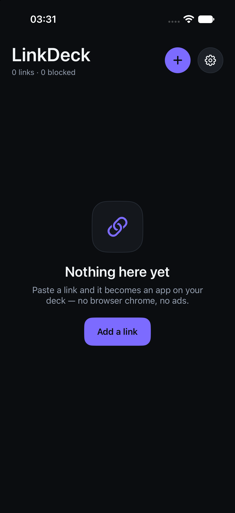
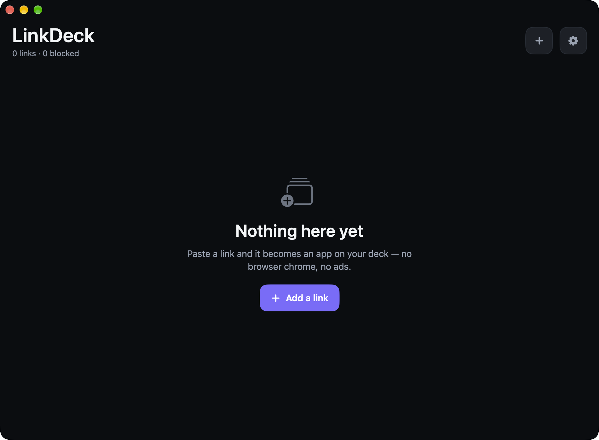
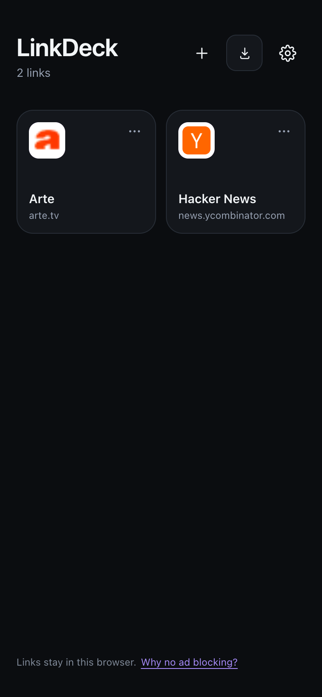
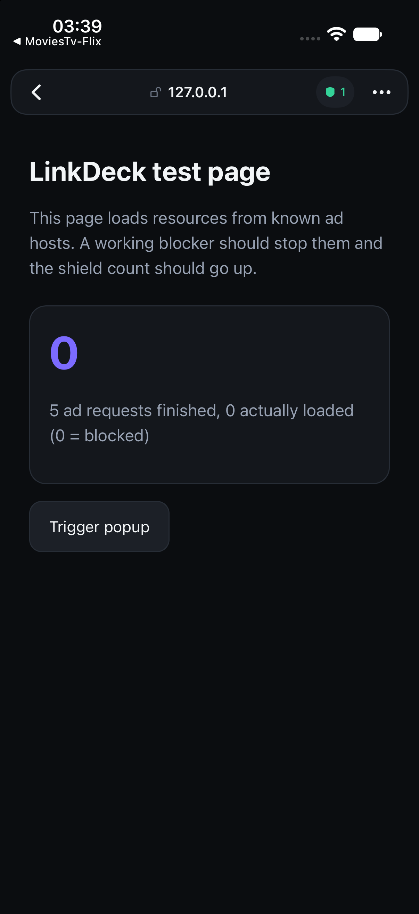

# LinkDeck

**Your links, as apps.** Paste any web address and it becomes a tile on a dark,
quiet deck. Tap it and the site opens full-screen with no browser chrome — no
address bar, no tabs, no ads, no popups.

One product, four builds: **Android**, **iOS**, **macOS**, and a **PWA**.

| iOS | macOS | PWA (mobile) |
| --- | --- | --- |
|  |  |  |

---

## What it does

- **A deck of your sites.** Adaptive grid, favicons (or deterministic letter
  tiles), names and hosts. Long-press / right-click for Open, Pin, Rename, Remove.
- **A browser with no chrome.** Full-screen web content, a floating header that
  gets out of the way, working back stack, desktop-site toggle, video fullscreen,
  and a menu to open the page in the system browser or delete the app.
- **Ad, tracker and popup blocking.** A bundled 6,603-domain blocklist is matched
  by domain suffix, so blocking `doubleclick.net` also blocks every subdomain.
  Ad slots are hidden and popups that were not triggered by a real tap are
  suppressed. The shield shows what each platform can measure: exact blocked
  requests on Android, cosmetic/popup filtering on WebKit.
- **Pin as an app.**
  - **Android:** a real pinned launcher shortcut with the site's favicon that
    boots straight into the site.
  - **macOS:** generates a real `.app` in `~/Applications/LinkDeck/` with the
    favicon as its icon, its own Dock presence, and no deck in between.
  - **PWA:** installs to the Dock/home screen and can open saved sites in their
    own standalone windows.
  - **iOS:** the deck is the home screen (iOS does not allow apps to create web
    clips), with a one-tap Safari hand-off and instructions.
- **Private by default.** No accounts, no sync, no analytics. The deck is local
  (prefs/JSON/localStorage). The only network calls are the pages you open and the
  favicon lookup (`icons.duckduckgo.com`).
- **No bundled links.** The apps ship empty, on purpose.

---

## Prebuilt binaries

`dist/` contains the four deliverables from `tools/package.sh`:

| File | Install |
| --- | --- |
| `LinkDeck-1.0.1-android.apk` | Sideload on Android 8+ (debug-signed). |
| `LinkDeck-1.0.1-ios-unsigned.ipa` | Re-sign with your team/profile, then install. |
| `LinkDeck-1.0.1-macos.zip` | Unzip, move `LinkDeck.app` to Applications, open. |
| `LinkDeck-1.0.1-pwa.zip` | Serve the folder over HTTP/HTTPS, or deploy it to any static host. |

`SHA256SUMS.txt` has the checksums. Rebuild all four with `./tools/package.sh`.

## Build & run

Each target is independent. You only need the toolchain for the one you want.
`tools/package.sh` builds every deliverable into `dist/` (APK, unsigned IPA,
macOS zip, PWA zip, SHA256SUMS).

### Android — `apps/android`

Requires JDK 17+ and the Android SDK (`local.properties` → `sdk.dir=...`).

```bash
cd apps/android
./install.sh                 # builds, installs on the first adb device, launches
# or
./gradlew assembleDebug      # -> app/build/outputs/apk/debug/app-debug.apk
```

`LinkDeck-debug.apk` in that folder is a ready-to-sideload debug build.

### iOS — `apps/ios`

Requires Xcode and XcodeGen.

```bash
cd apps/ios
./build.sh                   # simulator build, CODE_SIGNING_ALLOWED=NO
./run.sh                     # install + launch on the booted iPhone simulator
./build-ipa.sh               # unsigned device build -> LinkDeck-unsigned.ipa
```

`LinkDeck-unsigned.ipa` is an arm64 device build with no signing identity. Re-sign
it with your team (or a sideloading tool) before installing it on hardware. For a
signed build, open `LinkDeck.xcodeproj` (generated from `project.yml`), set your
team, and run.

### macOS — `apps/macos`

Requires Xcode and XcodeGen.

```bash
cd apps/macos
./build.sh                   # -> build/LinkDeck.app (ad-hoc signed)
open build/LinkDeck.app
./build/LinkDeck.app/Contents/MacOS/LinkDeck --self-test --pin-test
```

The self-test exercises URL normalization, storage, the blocklist, rule-list
generation, and a complete pin-as-app build (28 checks).

### PWA — `apps/pwa`

No build step, no dependencies.

```bash
cd apps/pwa
python3 -m http.server 4173
```

Open <http://localhost:4173>. Install with the in-app **Install** button
(Chromium), **File → Add to Dock** (Safari 17+), or **Share → Add to Home Screen**
(iOS). A service worker caches the shell, icons and blocklist for offline use.

---

## How blocking works

| | Android | iOS / macOS | PWA |
| --- | --- | --- | --- |
| Network blocking | `shouldInterceptRequest`, exact per-request counting | `WKContentRuleList` (cached), no per-request callback | **not possible** in a web page |
| Cosmetic + popups | `cosmetic.js` injected at document start | same script, all frames | n/a |
| Count shown | blocked requests (+ real number) | cosmetic + popup filtering | hidden (never faked) |

- `shared/blocklist.txt` — 6,603 unique domains, one per line, `#` comments.
  Built from the AdAway default mobile list plus a curated set of ad exchanges,
  popup networks and malvertising redirectors. Google video/CDN hosts are
  explicitly allowed so media keeps working.
- `shared/cosmetic.js` — hides empty ad slots and tracker iframes, kills
  `window.open()` that did not follow a real tap, and reports counts through a
  native bridge where one exists.
- Regenerate everything with `tools/build-blocklist.py` and
  `tools/sync-shared.sh` (icons included).
- Top-level navigation is never blocked. If a page you deliberately saved lives
  on a blocked domain, it still loads.

Blocking is intentionally conservative: it does not defeat server-side ad
insertion, and an ad that is fetched from the page's own domain will not be
blocked. Some sites may notice the empty responses.

---

## Layout

```
apps/
  android/   Kotlin · Material 3 · WebView + pinned shortcuts
  ios/       SwiftUI · WKWebView + content rule list
  macos/     SwiftUI/AppKit · WKWebView + generated .app bundles
  pwa/       Vanilla HTML/CSS/JS · manifest + service worker
shared/
  blocklist.txt   ad/tracker domains (suffix matching)
  cosmetic.js     cosmetic filter + popup guard
  icon/           one icon, every size (PNG, .icns, Android mipmaps)
  design.md       product + visual spec used by all four builds
tools/
  build-blocklist.py, make-icons.swift, sync-shared.sh
  testpage/        a page that loads real ad hosts, an ad slot and a popup
```

UI tokens are shared across platforms: background `#0B0D10`, surface `#14171C`,
1 px `#272D36` strokes, accent `#7C6BFF`, success `#34D399`, 20 pt tile corners.
See `shared/design.md`.

---

## Verification

| Target | Built | Run | Notes |
| --- | --- | --- | --- |
| Android | ✅ debug APK | ⚠️ not run here | No bootable system image on this Mac and the disk is nearly full; the APK was inspected with `aapt2` (label, icon, bundled assets). `install.sh` is ready for a device. |
| iOS | ✅ simulator (+ unsigned IPA script) | ✅ installed & launched on iPhone 17 | Deck, add sheet and browser run. Test page: 5 ad requests, **0 loaded**, ad slot hidden, shield incremented. |
| macOS | ✅ Release | ✅ launched + self-test | 28/28 self-test checks, including a generated pinned app and its signature. Screenshot above. |
| PWA | ✅ (static) | ✅ served + exercised | Puppeteer pass over add/rename/remove, context menus, `?app=`, install flow, offline reload and 404s; axe-core 0 violations. |

Try the blocker with `tools/testpage/index.html`: it requests five known ad
resources, adds an ad slot and a popup button. Serve it
(`python3 -m http.server 8099`) and open it as an app.



*iOS on the iPhone 17 simulator: 5 ad requests finished, 0 loaded; the ad slot is
hidden and the shield shows the cosmetic/popup count.*

---

## Known limits

- **PWA cannot block ads** on other sites — web pages cannot intercept another
  origin's requests. The PWA says so in Settings instead of faking a counter. Use
  the native builds for blocking.
- **iOS cannot add a home-screen web clip programmatically.** The deck is the
  launcher; "Open in Safari" plus Share → Add to Home Screen is offered.
- **WebKit gives no per-request blocking callback**, so iOS/macOS show cosmetic and
  popup filtering counts rather than an exact network count. Android counts every
  blocked request.
- **Generated macOS pinned apps** are copies of LinkDeck (~the app bundle size)
  with their own icon and identifier. Delete them from `~/Applications/LinkDeck`.
- **DRM and some players** depend on the platform WebView and may not play
  everywhere. Third-party cookies and autoplay are enabled for embedded players.
- **Desktop-site mode** changes the user agent only; sites with hard mobile
  redirects may still redirect.
- `usesCleartextTraffic` / mixed content are enabled on Android for older embedded
  players. Only save sites you trust.

---

## A note on content

LinkDeck is a general-purpose launcher and browser; it ships with no links and no
content. You are responsible for what you open. Ad blocking can conflict with a
site's terms, and streaming pirated content (for example kool.to, which the app
deliberately does not include or special-case) is illegal in many countries.
