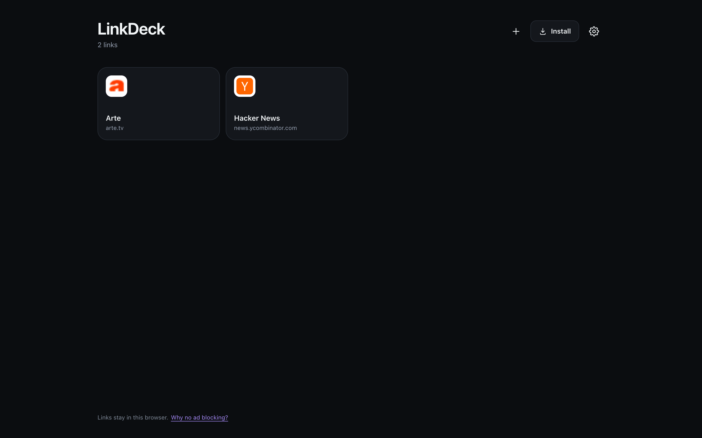

# LinkDeck — PWA

Your links, as apps. Save any site to a deck and open it from a quiet, dark grid.
This is the vanilla web build: no framework, no build step, no dependencies.



## Run it

Serve the folder over HTTP from its root:

```sh
cd apps/pwa
python3 -m http.server 4173
```

Open <http://localhost:4173>. A localhost (or HTTPS) origin is required for the
service worker and install prompt. Opening `index.html` from `file://` works as a
plain page, but not offline and not as an installable app.

## Install it

- **Chromium (Chrome, Edge, Brave):** use the LinkDeck **Install** button, the
  install icon in the address bar, or the browser menu → *Install LinkDeck*.
- **macOS Safari 17+:** **File → Add to Dock…**.
- **iOS / iPadOS Safari:** **Share → Add to Home Screen → Add**.

The installed app opens standalone, keeps the deck in its own window, and loads
offline after the first visit. The in-app install sheet adapts to these browsers,
including the iOS Home Screen steps.

## What it does

- **Deck** — 2 columns on phones, 3 on tablets, 4 on desktop; 150 px minimum tile,
  12 px gap, 20 px radius. Empty state, animated first appearance, and
  `prefers-reduced-motion` support.
- **Add a link** — URL and optional name, `https://` added automatically, http(s)
  validation, duplicate check, 40-character names, and a suggested name from the
  host (`www.arte.tv` → `Arte`).
- **Tiles** — DuckDuckGo favicon with a deterministic gradient letter fallback;
  never a broken-image icon. Host line and a shield pill only if a link carries a
  blocked count (the web build never creates one).
- **Context menu** — long-press or right-click, plus a visible menu button on
  touch. Open, Open in new window, Rename, Remove (with Undo). Keyboard:
  `Shift+F10` / Context Menu key, arrows, Home/End, Escape.
- **Open behaviour** — every tile is a real `https://…` anchor and opens with
  `window.open(url, '_blank', 'noopener')`. In standalone mode (or via *Open in
  new window*) a sized `popup` window is used so it feels app-like.
- **Start URLs** — `/?app=<id>` opens that saved link immediately. Unknown ids are
  removed from the URL with a toast. `/?app=<id>&embed=1` shows a full-bleed
  iframe with a fallback bar for sites that refuse framing.
- **Settings** — honest Blocking section, native-app repo links, live
  `blocklist.txt` count (non-comment lines) and a searchable domain preview.
  Data export/import JSON and clear-deck confirmation. Install entry point.
- **Offline** — versioned service worker cache, network-first navigation,
  cache-first shell and blocklist, cached favicons, custom 404 page, no console
  errors on an offline deck load.
- **First-open tip** — once per browser, explains that browser tabs cannot be
  ad-blocked and points to the Blocking section.
- **Data** — `localStorage` key `linkdeck.v1`, an array of:

  ```json
  {
    "id": "uuid",
    "name": "Arte",
    "url": "https://www.arte.tv/",
    "addedAt": "2026-01-01T12:00:00.000Z",
    "blocked": 0
  }
  ```

  Exports wrap the array in `{ "app": "LinkDeck", "version": 1, "links": [...] }`.
  Imports accept either shape, validate URLs, merge by URL, and skip duplicates.

## Accessibility

Semantic `header` / `main` / `footer`, real anchors and buttons, labelled icon
buttons, 44 px targets, visible focus rings, AA text contrast, focus trapping in
native `<dialog>` sheets, Escape-to-close (including from the domain search),
arrow-key tile navigation, and a screen-reader friendly live toast region.

## Limitations

- **No ad blocking in this build.** A web page cannot intercept requests made by
  another browser tab. Blocks are not counted, and no counter is faked. The
  native Android, iOS, and macOS apps filter requests inside their embedded web
  views; the bundled `blocklist.txt` and `cosmetic.js` are shown/kept for those
  apps. The web build only displays the blocklist as reference.
- **Embedded pages often refuse to load.** `X-Frame-Options` and
  `Content-Security-Policy: frame-ancestors` are enforced by the remote site. The
  fallback bar appears after a few seconds and offers *Open in browser*.
- **Browser tabs still have browser chrome and their own pop-up/tracker rules.**
  LinkDeck cannot remove another tab's URL bar, cookies, or ads.
- **`?app=` launches can be blocked by pop-up blockers** because the page opens a
  window without a tap. The toast offers an *Open* retry; tapping the tile always
  works. Per-app home-screen shortcuts are not generated in the web build — the
  manifest `start_url` stays `/`.
- **Storage is per browser profile.** `localStorage` is not synced or shared
  between browsers/devices. Clearing site data removes the deck; export a JSON
  backup first.
- **Favicons come from `icons.duckduckgo.com`.** If they fail or you are offline
  before the favicon cache is warm, the letter tile remains. URLs are limited to
  http(s) hosts containing a dot (so `localhost` is rejected).
- **Native folder links** (`../android/`, `../ios/`, `../macos/`) are repository
  paths. When this folder is served as the server root, those paths 404 unless
  the surrounding repo is also being served.
- No accounts, sync, analytics, playback keep-awake, or third-party cookie
  controls — those are native-app features.

## Files

| File | Purpose |
| --- | --- |
| `index.html` | App shell, sheets, embeds, toasts |
| `styles.css` | Design tokens, layout, dialogs, motion, focus states |
| `app.js` | Storage, rendering, dialogs, menus, install, start URLs |
| `sw.js` | Versioned app-shell cache and offline/404 fallback |
| `manifest.webmanifest` | Install metadata and icons |
| `404.html` | Safe not-found page (served by the service worker) |
| `blocklist.txt` | 6,597 bundled domains, for reference and the native apps |
| `cosmetic.js` | Native-web-view cosmetic filter, intentionally unused here |
| `icons/` | 192 / 512 / maskable-512 / Apple touch / favicon |
| `screenshot-desktop.png`, `screenshot-mobile.png` | Verification screenshots |
